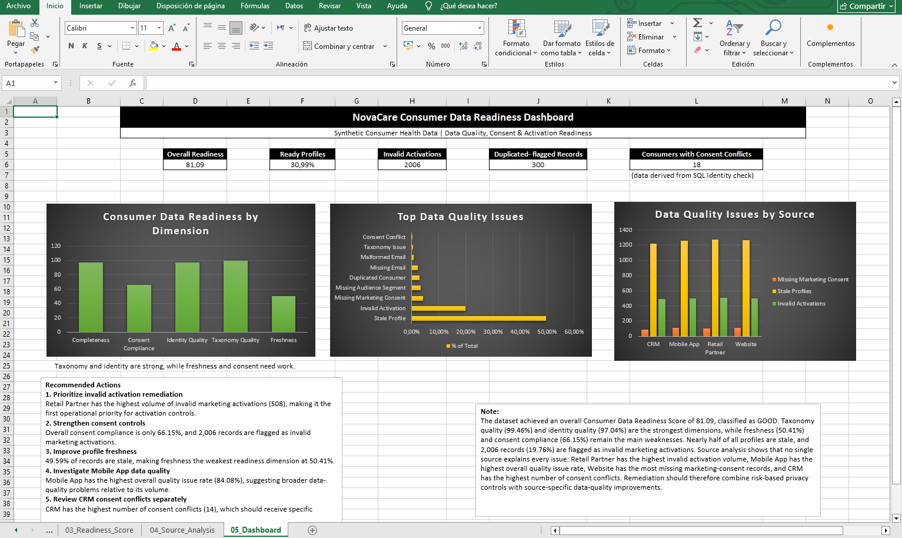
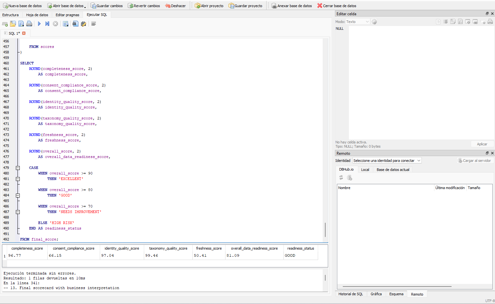

# NovaCare Consumer Data Readiness Analysis

## Project Overview

This project simulates a Consumer Data Readiness workflow for a fictional global Consumer Health company.

The objective was to evaluate whether consumer data from multiple marketing and customer-data sources was sufficiently accurate, consistent, privacy-compliant and structured for marketing activation.

All data used in this project is synthetic. No real consumer or personal data is included.

---

## Business Problem

Consumer data was collected from four different source systems:

- Website
- CRM
- Mobile App
- Retail Partner

The raw dataset contained intentional data-quality issues including:

- inconsistent country naming
- duplicate consumer identities
- missing and malformed email addresses
- inconsistent product and lifecycle taxonomies
- missing marketing consent
- consumers activated without valid marketing consent
- consent conflicts between duplicated identities
- missing audience segments
- stale consumer profiles

The objective was to identify these issues, standardize the data, flag problematic records and assess whether consumer profiles were ready for marketing activation.

---

## Tools Used

- SQL / SQLite
- DB Browser for SQLite
- Microsoft Excel
- PivotTables
- Structured Excel Tables
- Conditional Formatting
- Data validation and quality scoring

---

# SQL Workflow

## 1. Data Profiling and Harmonization

I first inspected the raw dataset to understand its structure and identify inconsistent values.

For example, the same country appeared in different formats:

- Spain
- ES
- ESP

I used SQL `CASE` logic to standardize these values into a common taxonomy while preserving the original raw dataset.

This followed a simple principle:

**Raw data should remain untouched, while cleaned and validated versions should be created separately.**

---

## 2. Duplicate and Identity Quality Analysis

I compared the total number of records with the number of unique consumer IDs to identify duplicated identities.

The dataset contained:

- 10,150 total records
- 10,000 unique consumers
- 150 additional duplicate records
- 300 records belonging to duplicated identities

I also checked for:

- duplicate email addresses
- missing email addresses
- malformed emails
- inconsistent marketing-consent values across duplicated consumer IDs

A key learning was that duplicated identities should not automatically be deleted.

In a real organization, merging records would require explicit survivorship rules, source-priority logic and a definition of which system should be considered authoritative.

---

## 3. Consent and Activation Validation

I analyzed whether consumer profiles activated for marketing had valid marketing consent.

The checks included:

- missing marketing consent
- invalid marketing activations
- consent issues by source system
- consent issues by country
- audience segmentation completeness
- stale profiles
- taxonomy consistency

The final validation identified:

- 421 records with missing marketing consent
- 2,006 records flagged as invalid marketing activations
- 18 consumer IDs with conflicting marketing-consent values

---

## 4. Validated Consumer Dataset

A validated dataset was created containing standardized values and row-level quality flags.

Examples of the flags created include:

- `missing_email_flag`
- `malformed_email_flag`
- `missing_marketing_consent_flag`
- `invalid_activation_flag`
- `duplicated_consumer_flag`
- `consent_conflict_flag`
- `missing_audience_segment_flag`
- `stale_profile_flag`
- `taxonomy_issue_flag`

A `quality_issue_count` was also created to show how many detected issues affected each record.

Profiles were classified into three activation-readiness statuses:

- `READY`
- `REVIEW`
- `NOT READY`

The classification was based on marketing consent, identity conflicts, email quality, audience segmentation and profile freshness.

---

# Consumer Data Readiness Score

I created an illustrative Consumer Data Readiness framework based on five dimensions:

| Dimension | Weight |
|---|---:|
| Completeness | 20% |
| Consent Compliance | 30% |
| Identity Quality | 20% |
| Taxonomy Quality | 15% |
| Freshness | 15% |

The weights are illustrative and would require agreement with Privacy, Data Governance, Marketing and other stakeholders in a real implementation.

Consent Compliance received the highest weight because consumer data may be technically complete and well structured but still be unsuitable for marketing activation if valid usage rights are missing.

---

## Results

| Dimension | Score |
|---|---:|
| Completeness | 96.77 |
| Consent Compliance | 66.15 |
| Identity Quality | 97.04 |
| Taxonomy Quality | 99.46 |
| Freshness | 50.41 |
| **Overall Data Readiness Score** | **81.09** |

**Readiness Status: GOOD**

---

# Key Findings

The dataset showed strong structural quality in taxonomy and identity management.

The strongest dimensions were:

- Taxonomy Quality: 99.46%
- Identity Quality: 97.04%
- Completeness: 96.77%

However, two areas materially reduced overall activation readiness.

## 1. Profile Freshness

Freshness was the weakest dimension at **50.41%**.

A total of **5,033 records**, or **49.59% of the dataset**, were considered stale based on the defined 365-day activity threshold.

This suggests that a significant proportion of the consumer profiles may no longer be sufficiently recent for effective targeting or personalization.

## 2. Consent Compliance

Consent Compliance scored **66.15%**.

A total of **2,006 records**, representing approximately **19.76% of all records**, were flagged as invalid marketing activations under the final validation rule.

This makes consent validation one of the most important operational risks in the dataset.

---

# Source-Level Analysis

The analysis showed that different source systems contributed different types of data-quality risk.

### Retail Partner

Retail Partner had the **highest volume of invalid marketing activations**, with:

- 508 invalid activations

This makes Retail Partner the first operational priority for activation-control remediation.

### Mobile App

Mobile App had the **highest overall quality issue rate**, at:

- 84.08%

This suggests broader data-quality problems relative to its total data volume.

### Website

Website had the **highest number of records with missing marketing consent**, with:

- 114 records

### CRM

CRM had the **highest number of consent conflicts**, with:

- 14 conflicting records

Although the absolute number is smaller than other quality issues, consent conflicts may require higher risk prioritization because of their privacy implications.

---

# Recommended Actions

## 1. Prioritize invalid activation remediation

Retail Partner should be the first operational priority because it has the highest volume of invalid marketing activations.

## 2. Strengthen consent controls

Consent Compliance is only 66.15%, and 2,006 records are currently flagged as invalid marketing activations.

Additional validation should be introduced before consumer profiles are sent to activation platforms.

## 3. Improve profile freshness

Almost half of all records are stale.

A freshness-monitoring process should identify inactive profiles and determine whether they should be refreshed, suppressed or excluded from specific activation use cases.

## 4. Investigate Mobile App data quality

Mobile App has the highest overall quality issue rate at 84.08%.

This suggests that the data feed or validation logic associated with the source should be reviewed in greater detail.

## 5. Review CRM consent conflicts separately

CRM contains the highest number of consent conflicts.

These records should be investigated separately because conflicting consent states may represent a higher privacy and compliance risk than other data-quality issues.

## 6. Introduce automated monitoring

Recurring checks should be automated for:

- invalid marketing activation
- missing consent
- duplicate identities
- consent conflicts
- profile freshness
- taxonomy compliance
- unusual changes in quality metrics

This would allow teams to identify issues earlier rather than discovering them after activation or reporting.

---

# Excel Analysis and Dashboard

The validated dataset was imported into Excel to translate technical data-quality findings into a business-facing analysis.

The workbook contains five sections:

1. `01_Validated_Data`
2. `02_Quality_Summary`
3. `03_Readiness_Score`
4. `04_Source_Analysis`
5. `05_Dashboard`

The Excel analysis includes:

- structured tables
- quality-issue summaries
- percentage calculations
- weighted readiness scoring
- PivotTables
- source-level comparisons
- conditional formatting
- business recommendations

The final dashboard summarizes:

- Overall Data Readiness Score
- Ready Profile percentage
- Invalid Marketing Activations
- Duplicate-Flagged Records
- Consumers with Consent Conflicts
- Readiness by Dimension
- Top Data Quality Issues
- Key Data Quality Issues by Source

---

# Dashboard Preview



---

# SQL Readiness Score



---

# What I Learned

This project helped me understand that data readiness is not simply a matter of deleting duplicates or filling missing values.

Consumer-data quality depends on a combination of:

- business rules
- privacy controls
- taxonomy standards
- identity-resolution logic
- source-system consistency
- profile freshness
- activation governance

One of the most important lessons was that conflicting identities cannot safely be merged without explicit survivorship rules and trusted-source hierarchies.

I also learned the importance of separating:

- raw data
- cleaned data
- validated data

so that transformations remain traceable and reversible.

Finally, the project demonstrated how SQL and Excel can be combined to move from technical data-quality checks to business prioritization and actionable recommendations.

---

# Project Structure

```text
01_Audience_Readiness/
│
├── data/
│   ├── novacare_consumers_raw.csv
│   └── novacare_data_dictionary.txt
│
├── sql/
│   ├── 01_country_harmonization.sql
│   ├── 02_duplicate_identity_checks.sql
│   ├── 03_consent_activation_checks.sql
│   ├── 04_build_validated_table.sql
│   └── 05_data_readiness_score.sql
│
├── excel/
│   ├── novacare_consumer_data_readiness.xlsx
│   ├── novacare_quality_by_source.xlsx
│   └── novacare_consumers_validated.csv
│
├── screenshots/
│   ├── dashboard.png
│   └── sql_readiness_score.png
│
├── novacare_consumer_data.db
└── README.md
```
