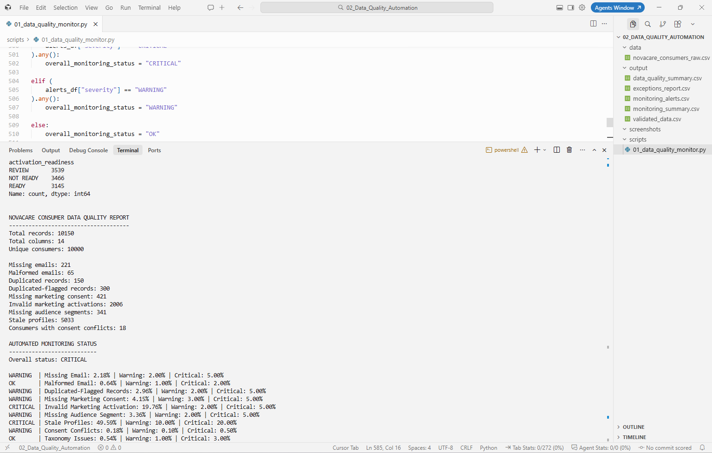

# NovaCare Automated Consumer Data Quality Monitor

## Project Overview

This project extends the NovaCare Consumer Data Readiness analysis by automating recurring consumer-data quality and activation-readiness checks using Python and pandas.

The objective was to move from a manual SQL-based analysis to a reusable monitoring workflow capable of:

- ingesting raw consumer data
- validating data quality
- standardizing selected taxonomy fields
- identifying privacy and activation risks
- classifying records by activation readiness
- detecting quality anomalies using configurable thresholds
- automatically generating operational reports

All data used in this project is synthetic. No real consumer or personal data is included.

---

## Business Problem

In a real consumer-data environment, data-quality checks cannot depend entirely on manual analysis.

New data may arrive repeatedly from systems such as:

- Website
- CRM
- Mobile App
- Retail Partner

If every new file requires someone to manually inspect missing values, duplicates, consent issues and activation errors, the process becomes difficult to scale.

The objective of this project was therefore to automate the validation workflow created in the previous SQL project.

The Python monitor evaluates new consumer data and produces standardized outputs that could support a data steward or marketing-data operations team.

---

## Tools Used

- Python
- pandas
- Cursor
- CSV data processing
- Rule-based monitoring
- Automated report generation

---

# Automated Workflow

The script follows this workflow:

```text
Raw Consumer Data
        ↓
Load with pandas
        ↓
Data Quality Validation
        ↓
Taxonomy Standardization
        ↓
Identity & Consent Checks
        ↓
Row-Level Quality Flags
        ↓
Activation Readiness Classification
        ↓
Anomaly / Severity Monitoring
        ↓
Automated Output Reports
```

---

## 1. Data Ingestion

The raw consumer dataset is loaded automatically using pandas:

```python
data = pd.read_csv("data/novacare_consumers_raw.csv")
```

The dataset contains:

- 10,150 records
- 10,000 unique consumers
- 14 original attributes

The script then evaluates the complete dataset without requiring manual filtering or inspection.

---

## 2. Automated Data Quality Checks

The monitor evaluates several quality dimensions.

Checks include:

- missing email addresses
- malformed email addresses
- duplicated consumer identities
- missing marketing consent
- invalid marketing activation
- missing audience segments
- stale consumer profiles
- conflicting consent states
- taxonomy inconsistencies

The final analysis identified:

- 221 missing emails
- 65 malformed emails
- 150 additional duplicate records
- 300 duplicated-flagged records
- 421 records with missing marketing consent
- 2,006 invalid marketing activations
- 341 records with missing audience segments
- 5,033 stale profiles
- 18 consumer IDs with conflicting marketing-consent values

---

## 3. Row-Level Quality Flags

Instead of only producing aggregate counts, the script creates quality flags for each individual record.

Examples include:

- `missing_email_flag`
- `malformed_email_flag`
- `duplicated_consumer_flag`
- `missing_marketing_consent_flag`
- `invalid_activation_flag`
- `missing_audience_segment_flag`
- `stale_profile_flag`
- `consent_conflict_flag`
- `taxonomy_issue_flag`

The boolean validation results are converted into:

```text
1 = issue detected
0 = no issue detected
```

This makes the results easy to aggregate, filter and use in downstream reporting tools.

---

## 4. Taxonomy Standardization

The Python workflow also standardizes inconsistent categorical values.

Examples include:

```text
ES → Spain
ESP → Spain

Skin Care → Skincare
skin-care → Skincare

NEW → New Customer
Active → Active Customer
```

Values that cannot be reliably mapped are classified as:

```text
Unknown
```

rather than being guessed.

---

## 5. Quality Issue Count

A `quality_issue_count` is created for each record.

This represents the total number of detected quality problems affecting that individual row.

For example:

```text
quality_issue_count = 0
```

means no monitored issue was detected.

While:

```text
quality_issue_count = 3
```

means the record triggered three separate quality checks.

This makes it easier to identify records requiring greater attention.

---

## 6. Activation Readiness Classification

Each consumer record is automatically classified as:

- `READY`
- `REVIEW`
- `NOT READY`

The decision is based on factors such as:

- marketing consent
- consent conflicts
- email quality
- audience segmentation
- profile freshness

The final dataset contained:

- 3,145 READY records
- 3,539 REVIEW records
- 3,466 NOT READY records

This creates a simple operational layer that could help determine which profiles require remediation before marketing activation.

---

## 7. Rule-Based Anomaly and Severity Monitoring

A monitoring layer was added to evaluate whether quality metrics exceed predefined thresholds.

Each monitored metric has:

- a current issue rate
- a warning threshold
- a critical threshold

A reusable Python function classifies every metric as:

```text
OK
WARNING
CRITICAL
```

For example:

```text
Invalid Marketing Activation
Current rate: 19.76%
Warning threshold: 2%
Critical threshold: 5%

Status: CRITICAL
```

The final monitoring status was:

```text
CRITICAL
```

because at least one monitored metric exceeded its critical threshold.

> **Why CRITICAL here but GOOD in Project 01?** These statuses answer different questions. Project 01 uses a weighted readiness score across multiple dimensions, while this monitor uses rule-based thresholds, where a single severe metric triggers an overall CRITICAL alert. The two results are complementary rather than contradictory.

### Monitoring Results

| Metric | Current Rate | Status |
|---|---:|---|
| Missing Email | 2.18% | WARNING |
| Malformed Email | 0.64% | OK |
| Duplicated-Flagged Records | 2.96% | WARNING |
| Missing Marketing Consent | 4.15% | WARNING |
| Invalid Marketing Activation | 19.76% | CRITICAL |
| Missing Audience Segment | 3.36% | WARNING |
| Stale Profiles | 49.59% | CRITICAL |
| Consent Conflicts | 0.18% | WARNING |
| Taxonomy Issues | 0.54% | OK |

The thresholds used in this prototype are illustrative.

In a real implementation, thresholds should be defined with relevant stakeholders such as:

- Data Governance
- Privacy
- Marketing
- Data Engineering
- source-system owners

They could also vary by market, source system or activation use case.

---

## 8. Why Rule-Based Monitoring?

I deliberately started with transparent rule-based monitoring rather than machine learning.

For privacy, consent and data-quality controls, deterministic rules have several advantages:

- they are easy to explain
- they are auditable
- thresholds are visible
- business owners can challenge or modify them
- alerts can be traced directly to the underlying rule

A future version could complement these controls with statistical anomaly detection once sufficient historical data is available.

For example, the system could learn normal ranges for:

- audience size
- consent rates
- identity-match rates
- missing-field rates
- campaign-tag volumes

and automatically flag unusual deviations.

---

## 9. Automated Outputs

Running the Python script automatically generates five files.

### `validated_data.csv`

Contains the original dataset plus:

- standardized fields
- quality flags
- issue counts
- activation-readiness classification

### `exceptions_report.csv`

Contains only records where at least one quality issue was detected.

This could be used as an operational remediation queue.

### `data_quality_summary.csv`

Contains aggregate quality metrics such as:

- total records
- unique consumers
- missing emails
- duplicates
- consent issues
- stale profiles

### `monitoring_alerts.csv`

Contains:

- metric
- current rate
- warning threshold
- critical threshold
- severity

### `monitoring_summary.csv`

Provides the overall monitoring status and counts of:

- critical metrics
- warning metrics
- OK metrics

### Monitoring Output Preview



---

## 10. Cross-Validation Between SQL and Python

An important part of this project was validating the Python results against the SQL analysis from the previous project.

During this comparison, I identified a discrepancy in the number of invalid marketing activations.

The Python implementation returned:

```text
2,006 invalid activations
```

while the original SQL implementation returned a lower value.

I investigated the difference and found that the initial SQL condition used:

```sql
marketing_consent <> 'YES'
```

However, SQL handles NULL values differently from normal comparisons.

A missing consent value does not automatically evaluate as:

```sql
NULL <> 'YES' = TRUE
```

The rule was therefore updated to explicitly identify:

- `NULL`
- blank values
- `NO`

as invalid consent states for activated profiles.

After correcting the SQL logic, both implementations returned:

```text
2,006 invalid marketing activations
```

This cross-validation exercise reinforced the importance of testing business rules across implementations rather than assuming that technically valid code necessarily produces the intended business result.

---

## 11. Key Findings

The automated monitor highlighted two major risks.

### Invalid Marketing Activation

The invalid activation rate was: **19.76%**

This exceeded the illustrative 5% critical threshold and was therefore classified as: **CRITICAL**

### Profile Freshness

The stale-profile rate was: **49.59%**

This significantly exceeded the illustrative 20% critical threshold.

These two dimensions are the primary drivers of the overall: **CRITICAL** monitoring status.

---

## 12. Potential Business Use

A similar monitoring workflow could be used to automatically validate incoming consumer-data feeds before they are used by:

- CDPs
- CRM systems
- media activation platforms
- audience segmentation tools
- measurement systems
- AI-driven personalization workflows

Instead of waiting for downstream users to identify problems manually, quality issues could be detected and surfaced when new data arrives.

---

## 13. Potential Next Improvements

Possible extensions include:

- source-specific monitoring thresholds
- market-specific privacy rules
- automatic email or Teams/Slack alerts
- historical trend monitoring
- statistical anomaly detection
- automated comparison against previous data loads
- consent-propagation checks
- integration with Power BI dashboards
- scheduling the validation workflow to run automatically

---

# What I Learned

This project helped me understand how manual data-quality logic can be converted into a repeatable automated workflow.

I learned how to use pandas to:

- load structured data
- work with DataFrames
- filter records
- identify missing values
- detect duplicated identities
- group data
- create new columns
- define reusable functions
- apply conditional business rules
- iterate through monitoring rules
- generate automated outputs

The most important lesson was that automation does not remove the need for business judgment.

Rules such as consent requirements, severity thresholds and identity survivorship logic still need to be defined and governed by the appropriate stakeholders.
