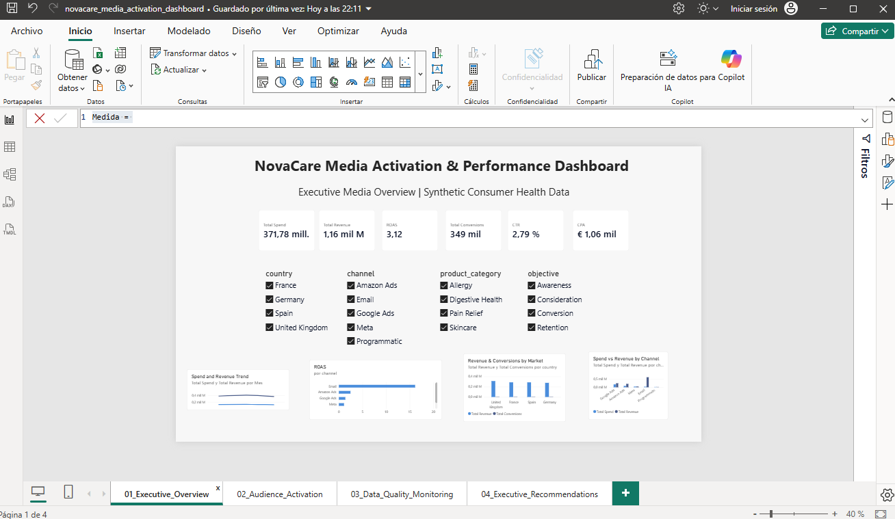
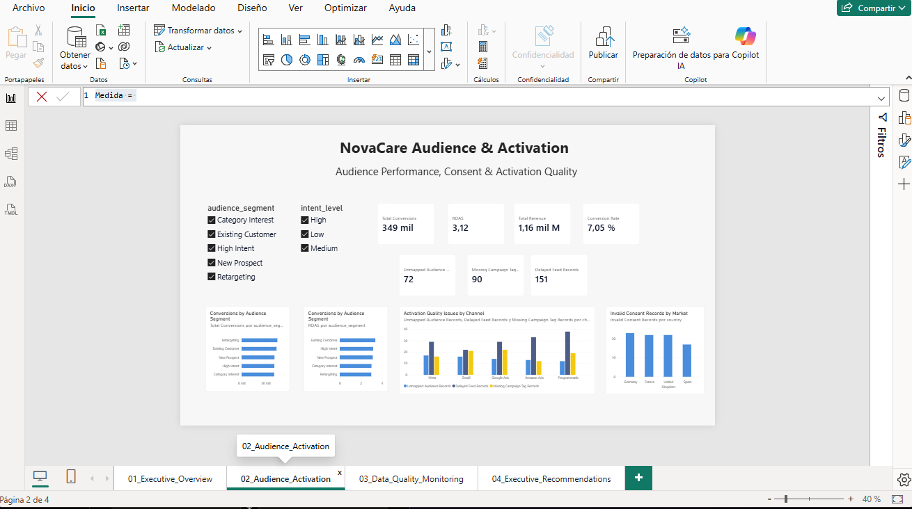
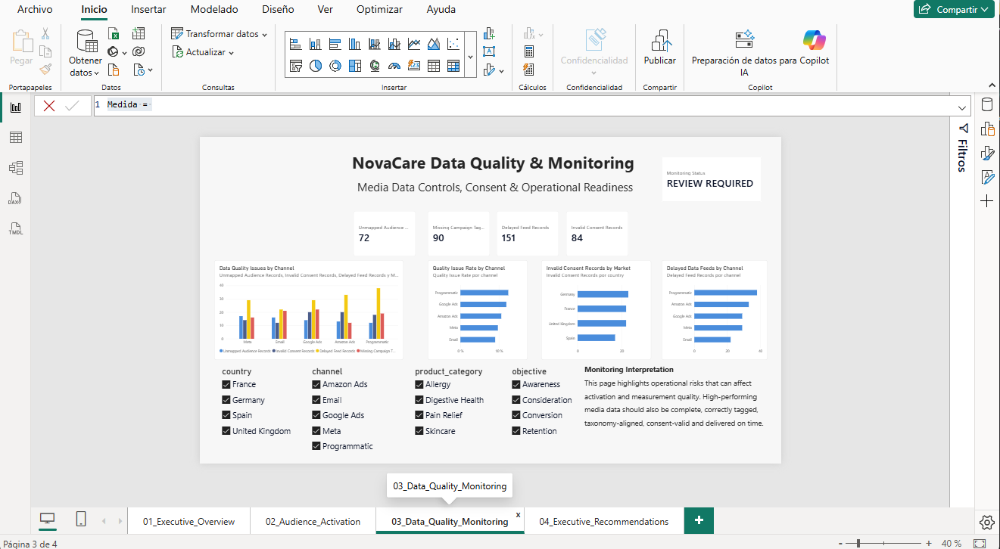
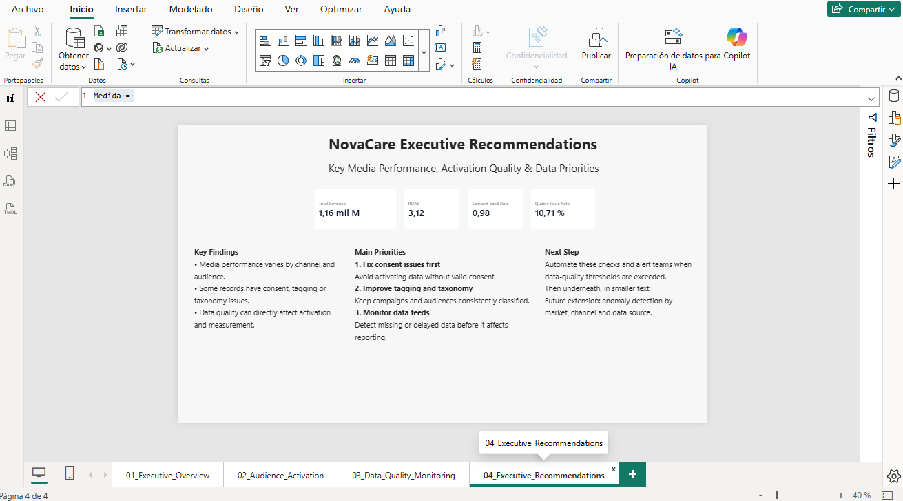
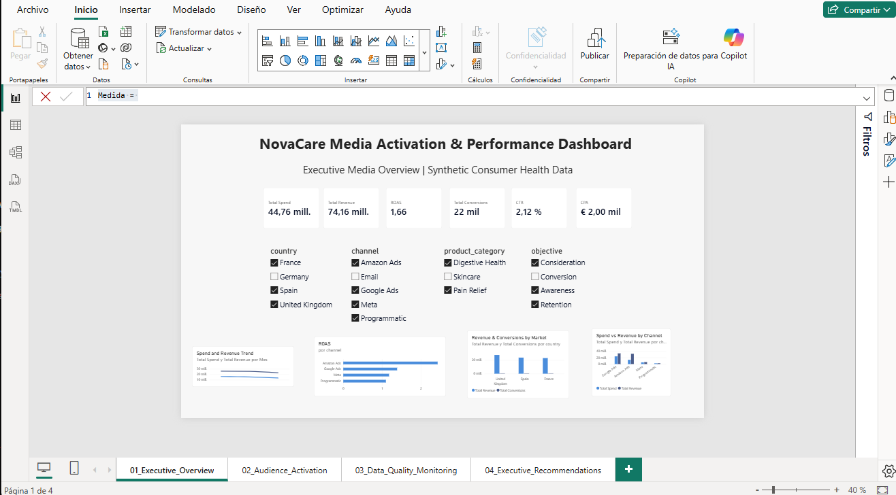

# NovaCare Media Activation & Performance Dashboard

## Overview

This project is a learning project designed to explore how media performance, audience activation and data quality can be monitored in Power BI.

The dataset represents a fictional consumer health company, NovaCare, operating across Spain, France, Germany and the United Kingdom.

All data used in this project is synthetic.

The objective was not only to analyse campaign performance, but also to connect marketing results with the quality and readiness of the underlying activation data.

---

## Business Questions

The dashboard was designed to answer four main questions:

1. How are media channels and markets performing?
2. Which audience segments generate the strongest results?
3. Is the data used for activation properly consented, classified and delivered?
4. Which data-quality issues should be prioritised?

---

## Dataset

The Power BI model uses three synthetic datasets:

- `novacare_media_performance.csv`
- `novacare_audience_taxonomy.csv`
- `novacare_campaign_metadata.csv`

The media performance dataset contains daily campaign information including:

- market
- media channel
- campaign
- audience
- impressions
- reach
- clicks
- spend
- conversions
- revenue
- consent status
- audience taxonomy status
- campaign tagging status
- feed status

---

## Data Model

A simple star-schema approach was used.

`novacare_media_performance` is the fact table.

Two dimension tables provide descriptive information:

- `novacare_audience_taxonomy`
- `novacare_campaign_metadata`

Relationships:

- `audience_taxonomy[audience_id]` → `media_performance[audience_id]`
- `campaign_metadata[campaign_id]` → `media_performance[campaign_id]`

This allows audience and campaign attributes to filter media-performance metrics dynamically.

---

## DAX Measures

Core media measures include:

- Total Spend
- Total Revenue
- Total Conversions
- Total Impressions
- Total Reach
- Total Clicks
- CTR
- CPC
- CPA
- Conversion Rate
- ROAS

Additional activation and data-quality measures include:

- Valid Consent Records
- Consent Valid Rate
- Invalid Consent Records
- Unmapped Audience Records
- Missing Campaign Tag Records
- Delayed Feed Records
- Quality Issue Rate
- Monitoring Status

Measures dynamically recalculate based on the filter context selected in the report.

---

## Dashboard Pages

### 1. Executive Media Overview

Provides a high-level view of media performance across channels and markets.

Key metrics include spend, revenue, ROAS, conversions, CTR and CPA.

Users can filter the analysis by market, channel, product category and campaign objective.

---

### 2. Audience & Activation

Connects audience performance with activation readiness.

The page compares audience segments using conversion and ROAS metrics while also monitoring:

- consent validity
- unmapped audiences
- missing campaign tags
- delayed feeds

---

### 3. Data Quality & Monitoring

Focuses on operational risks that can affect media activation and measurement.

The dashboard monitors issues including:

- invalid consent
- unmapped audience taxonomy
- missing campaign tags
- delayed data feeds

Both absolute issue counts and issue rates are used to identify where remediation should be prioritised.

---

### 4. Executive Recommendations

Translates the analysis into simple business priorities.

The main recommendations are:

1. Address consent problems before activation.
2. Improve campaign tagging and audience taxonomy consistency.
3. Monitor data feeds and quality indicators continuously.
4. Automate quality controls and alerts where possible.

---

## Interactive Filtering

Power BI slicers allow users to analyse the same metrics by country, channel, product category, campaign objective and audience segment.

The DAX measures automatically recalculate based on the selected filter context.

---

## Key Learning

This project helped me understand how Power BI can combine marketing-performance analysis with consumer-data readiness.

The main takeaway is that strong media performance alone is not enough. Data used for activation should also be consent-valid, consistently classified, properly tagged and available on time.

The project also provided practical experience with:

- Power BI data modelling
- star schemas
- table relationships
- DAX measures
- filter context
- KPI design
- interactive slicers
- audience-performance analysis
- data-quality monitoring

---

## Future Development

Possible next steps include:

- automated quality alerts
- historical anomaly detection by market and channel
- automated campaign-tag validation
- integration with CRM/CDP activation workflows
- AI-assisted investigation of recurring data-quality incidents
